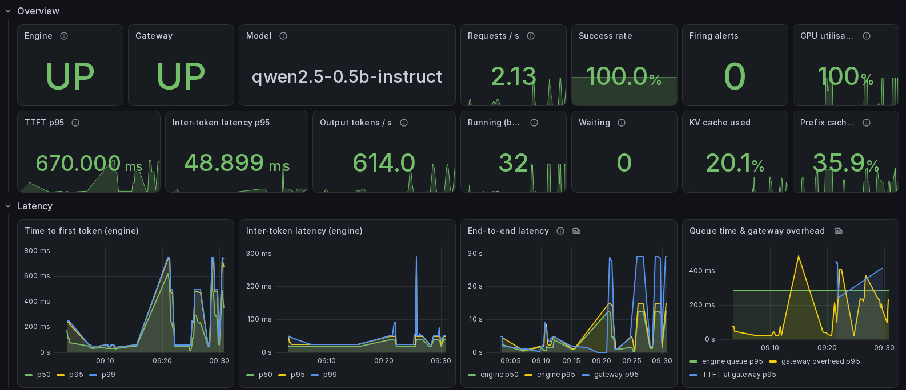
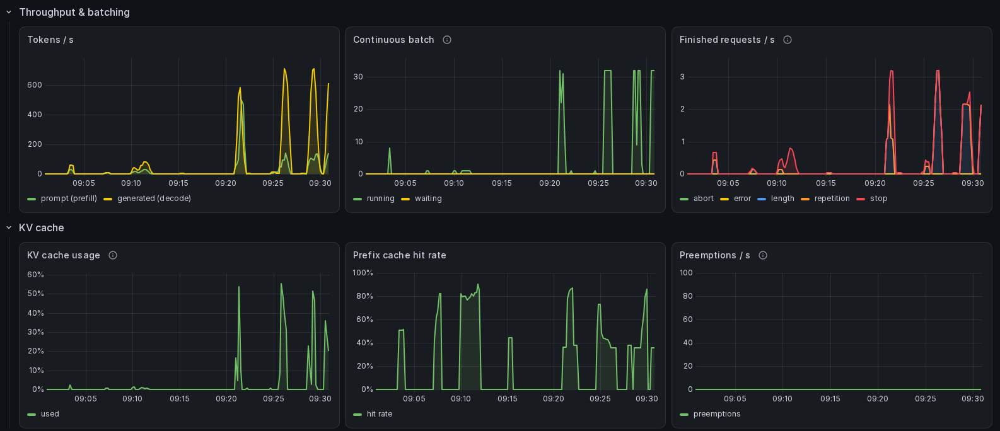
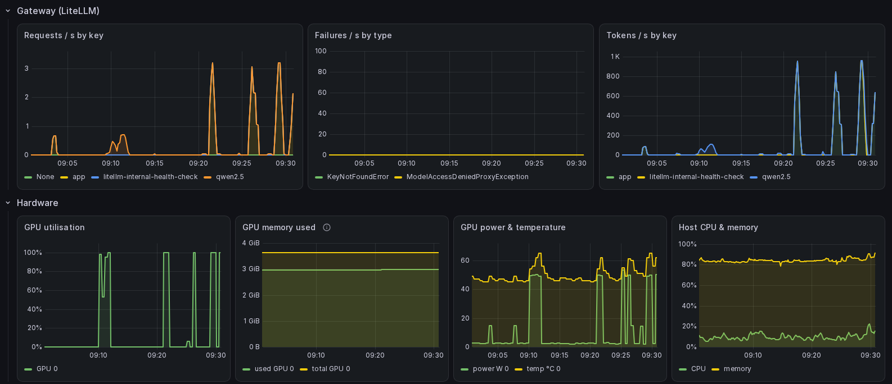
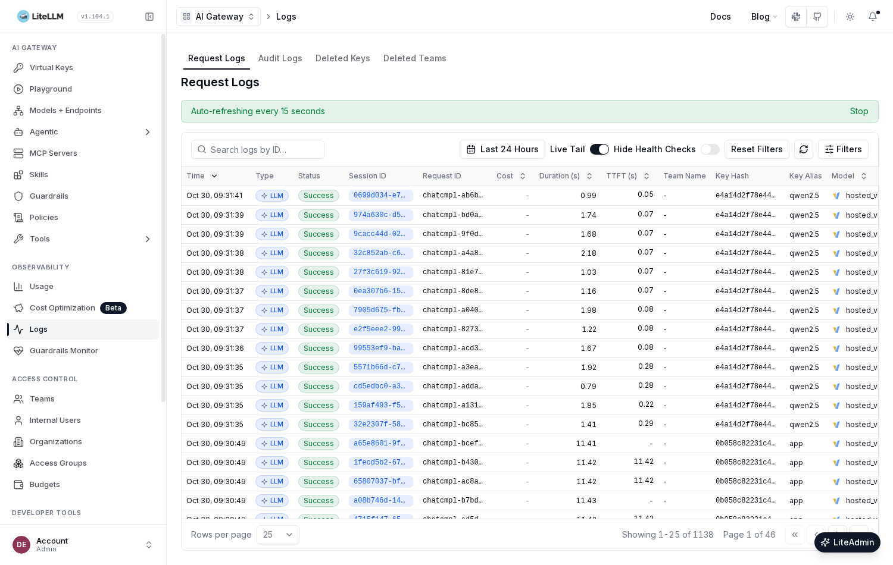
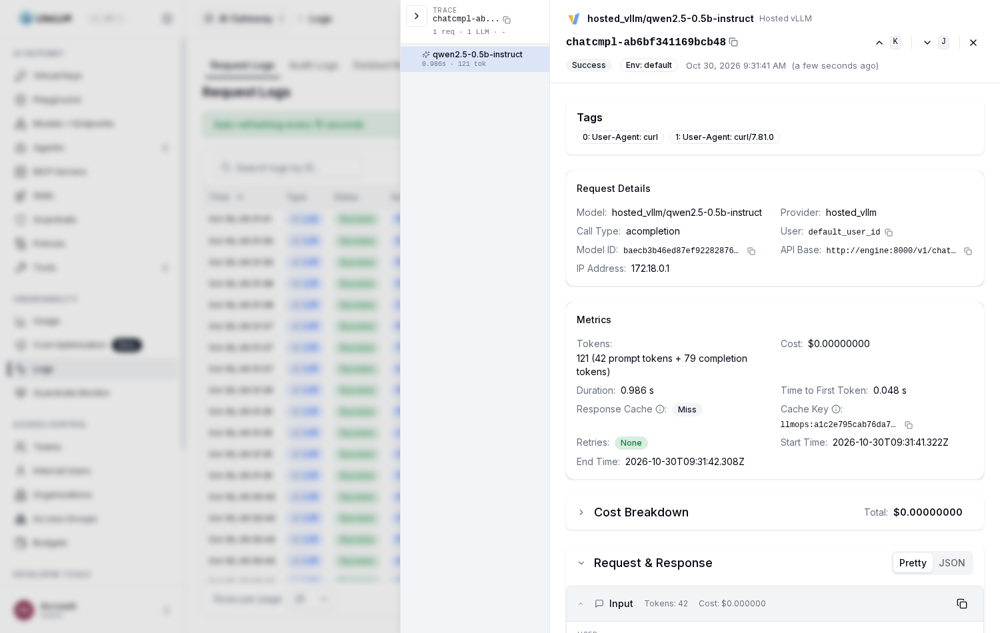
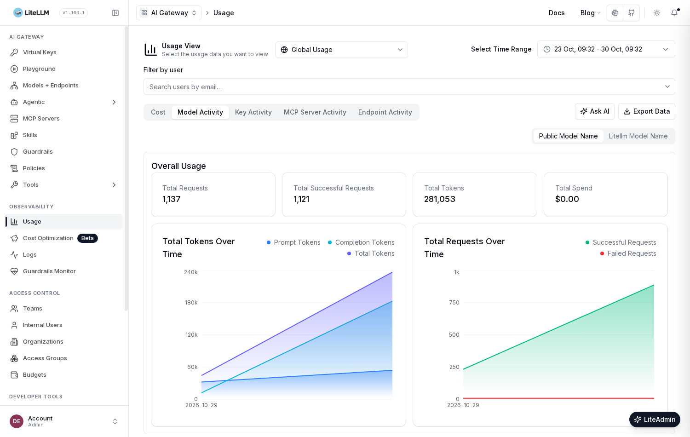

# LLMOps — LLM Endpoint with Observability, on Any Hardware

> **One command:** detect the hardware → pick a model that fits → serve it on vLLM behind an OpenAI-compatible gateway → watch it in Grafana.
> **Stack:** vLLM · LiteLLM · Prometheus · Loki · Grafana.

```bash
./run_all.sh                          # detect → start → self-heal → verify
./run_all.sh --model <hf-repo>        # serve another Hugging Face model
```

---

## Table of Contents

| # | Section | # | Section |
| :-: | :--- | :-: | :--- |
| 1 | [Overview](#1-overview) | 7 | [Batching, KV Cache & Latency](#7-batching-kv-cache--latency) |
| 2 | [Architecture](#2-architecture) | 8 | [Resilience](#8-resilience) |
| 3 | [Quick Start](#3-quick-start) | 9 | [Observability](#9-observability) |
| 4 | [Hardware](#4-hardware) | 10 | [Operations](#10-operations) |
| 5 | [Models](#5-models) | 11 | [Configuration](#11-configuration) |
| 6 | [Using the Endpoint](#6-using-the-endpoint) | 12 | [Troubleshooting](#12-troubleshooting) |
| | | 13 | [Repository Layout](#13-repository-layout) |

---

## 1. Overview

| Capability | How |
| :--- | :--- |
| **Serve** | Any Hugging Face model on vLLM: continuous batching, PagedAttention KV cache, prefix caching |
| **Any hardware** | NVIDIA · AMD ROCm · CPU (x86_64 / arm64) · Apple Silicon — the vLLM build is picked automatically |
| **Endpoint** | LiteLLM gateway: OpenAI API, virtual keys, rate limits, retries, opt-in response cache |
| **Batch** | Server-side continuous batching + `scripts/batch.py` for JSONL batch jobs (OpenAI Batch format) |
| **Observe** | One Grafana dashboard: latency, throughput, batching, KV cache, gateway, GPU, host, logs, alerts |
| **Resilient** | Health checks + autoheal, gateway retries, engine boot fallbacks, resumable batch jobs |

---

## 2. Architecture

### 2.1 Planes

```text
                   ┌──────────────────────────────────────────────────────────┐
                   │   CLIENT  ·  OPENAI SDK  ·  CURL  ·  scripts/batch.py    │
                   └────────────────────────────┬─────────────────────────────┘
                                                │ POST /v1/chat/completions  (stream · concurrent batch)
                                                │ Bearer LITELLM_API_KEY
                                                ▼
┌─────────────────────────────────────────────────────────────────────────────────────────────────┐
│ 1. GATEWAY PLANE — LiteLLM (:4000)                                                              │
│    • Virtual keys · budgets · rate limits (Postgres)     • Opt-in response cache (Redis)        │
│    • Retries · timeouts · cooldowns                      • Prometheus metrics (internal :9095)  │
└───────────────────────────────────────────────┬─────────────────────────────────────────────────┘
                                                │ OpenAI API → engine:8000
                                                ▼
┌─────────────────────────────────────────────────────────────────────────────────────────────────┐
│ 2. INFERENCE PLANE — vLLM 0.32 OpenAI server (:8000), build picked per hardware                 │
│    NVIDIA: vllm-openai (CUDA 13 / 12.9) · AMD: vllm-openai-rocm · CPU: vllm-openai-cpu          │
│    Apple Silicon: vllm-metal on the host                                                        │
│    • Continuous batching  • PagedAttention KV cache  • Automatic prefix caching                 │
└─────────────────┬───────────────────────────────────────────────────────────┬───────────────────┘
                  │ /metrics, 10 s scrape                                     │ container logs
                  ▼                                                           ▼
┌────────────────────────────────────────────────────┐ ┌──────────────────────────────────────────┐
│ 3. METRICS PLANE — Prometheus (:9090)              │ │ 4. LOGS PLANE — Alloy → Loki             │
│    engine · litellm · gpu (DCGM) · node            │ │    every container, label service=<name> │
│    10 alert rules (availability, latency, KV       │ │    7-day retention                       │
│    cache, queueing, GPU temperature, memory, disk) │ │                                          │
└─────────────────────────┬──────────────────────────┘ └────────────────────┬─────────────────────┘
                          │ PromQL                                          │ LogQL
                          ▼                                                 ▼
┌─────────────────────────────────────────────────────────────────────────────────────────────────┐
│ 5. VISUALIZATION PLANE — Grafana (:3001), dashboard "LLM Serving"                               │
│    Overview · Latency · Throughput & batching · KV cache · Gateway · Hardware · Logs & alerts   │
└─────────────────────────────────────────────────────────────────────────────────────────────────┘
┌─────────────────────────────────────────────────────────────────────────────────────────────────┐
│ 6. RESILIENCE — restart policies · health checks · autoheal (restarts unhealthy containers) ·   │
│    gateway retries · run_all.sh boot fallbacks (shorter context → smaller model → CPU)          │
└─────────────────────────────────────────────────────────────────────────────────────────────────┘
```

### 2.2 Request Path

```text
Client            LiteLLM (:4000)                  vLLM engine (:8000)                Prometheus · Loki
  │                     │                                   │                                   │
1 │── POST /v1/chat ───>│                                   │                                   │
2 │                     │── key · rate limit · opt-in cache │                                   │
3 │                     │── forward (retry on 5xx/timeout) ─>│                                   │
4 │                     │                                   │── join the running batch           │
5 │                     │                                   │   reuse cached prefix KV blocks    │
6 │                     │<──────────── stream tokens ───────│                                   │
7 │<── SSE tokens ──────│── cache store (opt-in)            │                                   │
  │                     │                                   │                                   │
  │                     │<┄┄┄┄┄┄┄┄┄┄┄┄┄┄┄┄┄┄┄┄┄┄┄┄┄┄ scrape :9095 ┄┄┄┄┄┄┄┄┄┄┄┄┄┄┄┄┄┄┄┄┄┄┄┄┄┄┄┄┄┄┄│
  │                     │                                   │<┄┄┄┄ scrape /metrics (10 s) ┄┄┄┄┄┄│
  │                     │┄┄┄┄┄┄┄┄┄ container logs (Alloy) ┄┄┄┄┄┄┄┄┄┄┄┄┄┄┄┄┄┄┄┄┄┄┄┄┄┄┄┄┄┄┄┄┄┄┄>│
```

### 2.3 Network Exposure

```text
┌──────────────────────────────────────────────┐ ┌──────────────────────────────────────────────┐
│ PUBLIC_BIND_ADDRESS (default 127.0.0.1)      │ │ BIND_ADDRESS (127.0.0.1) · no login          │
│ login required                               │ │                                              │
│   LiteLLM gateway + UI   :4000               │ │   vLLM engine            :8000               │
│   Grafana                :3001               │ │   Prometheus             :9090               │
└──────────────────────────────────────────────┘ └──────────────────────────────────────────────┘
  Docker network only: Postgres · Redis · Loki · Alloy · node-exporter · DCGM · LiteLLM metrics :9095
```

---

## 3. Quick Start

```bash
git clone <repo> && cd LLMOps
./run_all.sh
```

| Step | What `run_all.sh` does |
| :-: | :--- |
| 1 | Docker check (Ubuntu: installs Docker + NVIDIA container toolkit when missing); `.env` with fresh secrets |
| 2 | Hardware → vLLM build (section 4) |
| 3 | Model that fits, context length, batch size, GPU memory share (section 5) |
| 4 | Pulls images, starts the stack, waits for the engine (download + compile), falls back if it cannot boot |
| 5 | End-to-end checks: engine, gateway (auth, chat, streaming, batch, cache), metrics, alerts, dashboard, logs |

- **Never prompts** — every automatic change is listed under *Adjusted automatically*.
- **Prints** — endpoint URL, model name, API key, Grafana login.
- **Requirements** — Linux or macOS, Docker, Python 3.8+; disk: vLLM CUDA image ≈ 9 GB download (CPU image ≈ 1.7 GB) plus model weights.

---

## 4. Hardware

One engine everywhere — vLLM — in the build that fits:

| Hardware | vLLM build |
| :--- | :--- |
| NVIDIA GPU, driver 580+, compute 7.5+ | `vllm/vllm-openai:v0.32.0` (CUDA 13) |
| NVIDIA GPU, older driver or compute 7.0 (V100) | `vllm/vllm-openai:v0.32.0-cu129` (CUDA 12.9) |
| AMD GPU (ROCm) | `vllm/vllm-openai-rocm:v0.32.0` |
| CPU only (x86_64 AVX2 / AVX-512, arm64) | `vllm/vllm-openai-cpu:v0.32.0` |
| Apple Silicon | vllm-metal on the host (`brew install vllm-project/vllm-metal/vllm-metal`); without it, vLLM CPU in Docker |

- **Same everywhere** — same flags, OpenAI API, metric names and dashboard.
- **Override** — `--cpu` ignores the GPU; `GPU_COUNT=2` serves one model on the 2 GPUs with the most free memory.
- **GPU telemetry** — NVIDIA via DCGM exporter; AMD / Apple: not collected.
- **GTX 16xx / MX GPUs** (Turing without Tensor Cores) — served in float32: batched fp16 matmuls run ~30× slower there (GTX 1650, 32 streams: 160 → 745 tokens/s).
- **Verified** (2026-10-30, laptop: GTX 1650 4 GB · Ryzen 7 4800H · 14 GB RAM, `Qwen2.5-0.5B-Instruct`):

  | Scenario | Result |
  | :--- | :--- |
  | GPU (float32, auto) | 16/16 checks · 64 streams at 16 concurrent: TTFT p50 0.18 s / p95 0.62 s, 290 tokens/s via gateway |
  | CPU fallback (vLLM CPU, AVX2) | 16/16 checks · TTFT 0.55 s |
  | Cold start after `--down` · re-run with stack up | 80 s · 12 s (running engine untouched) |
  | Engine core killed | container restarted, serving again after 61 s |
  | Not tested here | AMD ROCm · Apple Silicon · multi-GPU · data-center GPUs |
- **Why no Triton** — for LLMs, Triton's vLLM backend only wraps vLLM (which does the batching and KV cache itself) and adds a ~10 GB image, an older vLLM and a beta OpenAI frontend. It pays off only when non-LLM models or ensembles must be hosted next to the LLM.

---

## 5. Models

| Hardware | Default model | Context |
| :--- | :--- | :-: |
| GPU ≥ 14 GiB free | `Qwen/Qwen3-4B-Instruct-2507` | 32K |
| GPU 7–14 GiB | `Qwen/Qwen2.5-1.5B-Instruct` | 16K |
| GPU < 7 GiB | `Qwen/Qwen2.5-0.5B-Instruct` | 16K (GTX 16xx / MX: 8K, float32) |
| CPU ≥ 30 GiB RAM + 16 threads | `Qwen/Qwen2.5-1.5B-Instruct` | 8K |
| CPU (smaller) | `Qwen/Qwen2.5-0.5B-Instruct` | 8K |
| Apple Silicon ≥ 24 / ≥ 12 GiB | 4B / 1.5B as above | 32K / 16K |

```bash
./run_all.sh --model Qwen/Qwen2.5-7B-Instruct        # any Hub repo (saved as MODEL in .env)
```

- **Defaults** — non-thinking instruct models (answer directly → low latency), not gated.
- **API name** — `SERVED_MODEL_NAME`, default: repo name in lower case (e.g. `qwen2.5-7b-instruct`).
- **Private / gated** — `HF_TOKEN` in `.env` (or `hf auth login`).
- **Too big** — the engine fails to boot → shorter context → default model for the hardware (section 8).
- **Thinking / tool calling** — add the parser flags, e.g. `VLLM_EXTRA_ARGS="--reasoning-parser qwen3 --enable-auto-tool-choice --tool-call-parser hermes"`.

---

## 6. Using the Endpoint

### 6.1 cURL

```bash
source <(grep -E '^(LITELLM_API_KEY|LITELLM_PORT)=' .env)
curl http://localhost:${LITELLM_PORT}/v1/chat/completions \
  -H "Authorization: Bearer $LITELLM_API_KEY" -H 'Content-Type: application/json' \
  -d '{"model": "qwen2.5-0.5b-instruct", "stream": true,
       "messages": [{"role": "user", "content": "Explain the KV cache in one sentence."}]}'
```

### 6.2 Python (OpenAI SDK)

```python
from openai import OpenAI
client = OpenAI(base_url="http://localhost:4000/v1", api_key="<LITELLM_API_KEY>")
r = client.chat.completions.create(model="qwen2.5-0.5b-instruct",
                                   messages=[{"role": "user", "content": "Hello"}])
print(r.choices[0].message.content)
```

- **Notebook** — `test/litellm_api_test.ipynb`: chat + streaming (with time to first token). Reads the key from `LITELLM_API_KEY_QWEN` (environment or `.env`, never printed; empty → `LITELLM_API_KEY`).
- **Own keys** — create one in the UI (*Virtual Keys*), put it in `.env` as `LITELLM_API_KEY_QWEN=…`; never commit keys.

### 6.3 Batch Jobs

```bash
python3 scripts/batch.py examples/batch.jsonl results.jsonl --concurrency 32
```

- **Input / output** — OpenAI Batch API JSONL (`custom_id`, `body`) → one result line per request.
- **Throughput** — requests run concurrently; vLLM batches them (continuous batching).
- **Resilient** — 429 / 5xx / connection errors retried with backoff; re-running resumes (finished lines kept).

### 6.4 Request Options

| Option | How |
| :--- | :--- |
| Use the response cache (off by default) | body `"cache": {"use-cache": true}`: an identical request within 1 h is answered from Redis (Logs: duration ≈ 0, no TTFT) |
| New keys, budgets, rate limits | UI `http://localhost:4000/ui` (admin + `LITELLM_MASTER_KEY`) or `POST /key/generate` |
| Per-request history (prompt, response, tokens, latency) | UI → Logs; bodies are stored in Postgres (`store_prompts_in_spend_logs` in `config/litellm.yaml`, set `false` to stop) |
| Engine directly (no key, server-local) | `curl localhost:8000/v1/models` |

---

## 7. Batching, KV Cache & Latency

| Feature | Where | Knob (`.env`) |
| :--- | :--- | :--- |
| Continuous batching | vLLM scheduler: new requests join the running batch every step | `MAX_NUM_SEQS` |
| PagedAttention KV cache | GPU memory share for weights + KV blocks (CPU: RAM) | `GPU_MEMORY_UTILIZATION`, `CPU_KV_CACHE_GB` |
| Automatic prefix caching | shared prompt prefixes (system prompts, chat history) reuse KV blocks | always on |
| Chunked prefill | long prompts do not stall running decodes | vLLM default |
| CUDA graphs / compile cache | kernels cached in the `engine_cache` volume → fast restarts | — |
| Response cache | identical requests answered from Redis without the engine (opt-in) | `cache.use-cache` per request · `mode` in `config/litellm.yaml` |
| Gateway workers | parallel LiteLLM processes, sized by CPU threads | `LITELLM_NUM_WORKERS` |

```bash
python3 scripts/load_test.py --concurrency 16 --requests 64      # TTFT, latency, tokens/s
```

- **Watch** — dashboard rows *Throughput & batching* and *KV cache* while it runs.
- **KV cache full** — lower `MAX_MODEL_LEN` / `MAX_NUM_SEQS`, smaller model, or more GPU memory.

---

## 8. Resilience

| Failure | Handling |
| :--- | :--- |
| Container crashes (incl. vLLM engine core) | `restart: unless-stopped` |
| Container hangs (health check fails) | `autoheal` restarts containers labelled `autoheal=true` (engine, gateway) |
| Engine restarting / overloaded | LiteLLM retries 5xx and timeouts (2×), drops unsupported params, 600 s timeout |
| Engine cannot boot | `run_all.sh`: shorter context → smaller model → CPU (listed in the report) |
| Model not downloadable | gated / private / misspelled → default model for the hardware |
| Busy host port | moved to the next free port, saved in `.env` |
| Registry offline | cached images used |
| Batch job interrupted | `scripts/batch.py` resumes (finished lines kept); `--cache` also answers repeats from Redis |

---

## 9. Observability

### 9.1 Grafana — dashboard "LLM Serving"

Grafana `http://localhost:3001` → dashboard **LLM Serving** (home page).

| Row | Panels |
| :--- | :--- |
| Overview | engine / gateway up, model, requests/s, success rate, alerts, GPU %, TTFT p95, ITL p95, tokens/s, running / waiting, KV cache %, prefix hits |
| Latency | TTFT · inter-token latency · end-to-end (engine vs gateway) · queue time + gateway overhead |
| Throughput & batching | prompt vs generated tokens/s · running vs waiting requests · finished requests by reason |
| KV cache | usage · prefix cache hit rate · preemptions |
| Gateway (LiteLLM) | requests, failures, tokens per key |
| Hardware | GPU utilisation, memory, power, temperature · host CPU and memory |
| Logs & alerts | firing alerts · engine + gateway errors (incl. rejected API keys) · all logs (filter by service) |

- **Same metrics on every platform** — vLLM's own `/metrics` (`vllm:*`), whatever the hardware.
- **Alerts** — `config/prometheus/alerts.yml`; firing ones on the dashboard and `http://localhost:9090/alerts`. Notifications: add an Alertmanager or a Grafana contact point.
- **Logs** — Explore → Loki → `{service="engine"}` (also `litellm`, `prometheus`, …). Kept 7 days in the `loki_data` volume, across restarts and `--down`.

Under a batch job (128 requests, 32 in flight, GTX 1650):





### 9.2 LiteLLM UI — requests, keys, usage

`http://localhost:4000/ui` (admin + `LITELLM_MASTER_KEY`).

| Page | Shows |
| :--- | :--- |
| Logs | every request: key, model, tokens, duration, TTFT, cache hit; prompt and response (`store_prompts_in_spend_logs`) |
| Usage | requests, tokens and failures per model, key and endpoint (tabs *Model / Key / Endpoint Activity*; *Cost* stays $0 for a self-hosted model without a price) |
| Virtual Keys | create keys, limit models, budgets, rate limits |

- **TTFT** — measured for streamed requests only; a non-streamed answer arrives in one piece, so Logs shows `-`. Engine TTFT for every request: Grafana.
- **Duration ≈ 0** — answered from the response cache (only when the request opts in with `"cache": {"use-cache": true}`).





---

## 10. Operations

| Task | Command |
| :--- | :--- |
| Start / redeploy + verify | `./run_all.sh` |
| Switch model | `./run_all.sh --model <hf-repo>` |
| Verify running stack | `./run_all.sh --test` |
| Stop (weights + data kept) | `./run_all.sh --down` |
| Status / logs | `docker compose ps` · `docker compose logs -f engine` |
| Restart one service | `docker compose restart litellm` |
| Reload alert rules | `curl -X POST localhost:9090/-/reload` |
| Load test | `python3 scripts/load_test.py` |
| Back up keys / spend | `docker exec llmops-postgres pg_dump -U llmops_admin litellm_db > backup.sql` |

- **Plain compose works** — `run_all.sh` saves the compose file list as `COMPOSE_FILE` in `.env`.
- **Reboot** — containers come back by themselves.
- **Upgrades** — versions pinned in `.env` (`VLLM_VERSION`, `LITELLM_VERSION`, …); bump, then `./run_all.sh`.
- **Remote host** — UIs stay on 127.0.0.1: `ssh -N -L 4000:localhost:4000 -L 3001:localhost:3001 user@host`; or set `PUBLIC_BIND_ADDRESS=0.0.0.0` and open TCP 4000 / 3001 to your IP only (plain HTTP).

---

## 11. Configuration

`.env` (created from `.env.example`; empty = automatic):

| Group | Keys |
| :--- | :--- |
| Model | `MODEL` · `SERVED_MODEL_NAME` · `MAX_MODEL_LEN` · `MAX_NUM_SEQS` · `GPU_MEMORY_UTILIZATION` · `DTYPE` · `GPU_COUNT` · `CPU_KV_CACHE_GB` · `HF_TOKEN` · `HF_CACHE_DIR` |
| Engine | `VLLM_EXTRA_ARGS` · `ENGINE_START_PERIOD` |
| Gateway | `LITELLM_MASTER_KEY` · `LITELLM_API_KEY` · `LITELLM_API_KEY_QWEN` (optional, for `test/`) · `LITELLM_NUM_WORKERS` · `POSTGRES_*` · `REDIS_PASSWORD` |
| Grafana | `GF_SECURITY_ADMIN_USER` · `GF_SECURITY_ADMIN_PASSWORD` |
| Network | `PUBLIC_BIND_ADDRESS` · `BIND_ADDRESS` · `PUBLIC_HOST` · `*_PORT` |
| Versions | `VLLM_VERSION` · `LITELLM_VERSION` · `PROMETHEUS_VERSION` · `GRAFANA_VERSION` · `LOKI_VERSION` · `ALLOY_VERSION` · `DCGM_EXPORTER_VERSION` |
| Set by run_all.sh | `COMPOSE_FILE` |

- **Gateway policy** — `config/litellm.yaml` (retries, cache, extra deployments for load balancing / failover).
- **Upgrading from the previous stack** — the old `.env` is kept as `.env.previous-stack.*`; secrets and the team key carry over.

---

## 12. Troubleshooting

| Symptom | Fix |
| :--- | :--- |
| Engine `health: starting` for minutes | first boot downloads weights + compiles; `docker compose logs -f engine` |
| `NVIDIA GPU found but Docker cannot use it` | `bash scripts/bootstrap_host.sh` (NVIDIA container toolkit) |
| Old NVIDIA driver (< 580) | handled: the CUDA 12.9 build of vLLM is used |
| `Cannot download <model>` | accept the license on huggingface.co / set `HF_TOKEN` |
| KV cache alert | lower `MAX_MODEL_LEN` / `MAX_NUM_SEQS`, or a smaller model |
| Port moved (e.g. Grafana on 3002) | another program held it; see `*_PORT` in `.env` |
| `401` from the gateway | use `LITELLM_API_KEY` from `.env` (the master key is for admin) |
| Slow on CPU | expected: a few to tens of tokens/s; keep models ≤ 1.5B |
| LiteLLM Logs: TTFT `-` | request was not streamed (`stream: true` to measure it) |
| LiteLLM Logs: duration 0.00, same request ID | cache hit: the request sent `"use-cache": true` |
| LiteLLM Logs: no prompt / response | request was sent before `store_prompts_in_spend_logs: true` |

---

## 13. Repository Layout

```text
LLMOps/
├── run_all.sh                    # detect · size · start · self-heal · verify
├── docker-compose.yml            # gateway, Postgres, Redis, Prometheus, Loki, Alloy, Grafana, autoheal
├── compose/
│   ├── vllm.yml                  # engine: vLLM in Docker (NVIDIA, ROCm, CPU)
│   ├── native.yml                # engine on the host (Apple Silicon)
│   ├── nvidia.yml                # GPU access + DCGM exporter
│   └── rocm.yml                  # AMD device access
├── config/
│   ├── litellm.yaml              # gateway policy
│   ├── prometheus/               # scrape jobs, engine / GPU scrape files, alert rules
│   ├── loki.yaml · alloy.alloy   # logs
│   └── grafana/                  # datasources + "LLM Serving" dashboard
├── scripts/
│   ├── smoke_test.py             # end-to-end checks
│   ├── batch.py                  # JSONL batch jobs
│   ├── load_test.py              # streaming load test
│   ├── llm_client.py             # shared asyncio HTTP client
│   └── bootstrap_host.sh         # Ubuntu: Docker + NVIDIA container toolkit
├── test/litellm_api_test.ipynb   # OpenAI SDK against the gateway: chat + streaming
├── examples/batch.jsonl
├── docs/images/                  # screenshots (Grafana, LiteLLM UI)
└── .env.example
```
